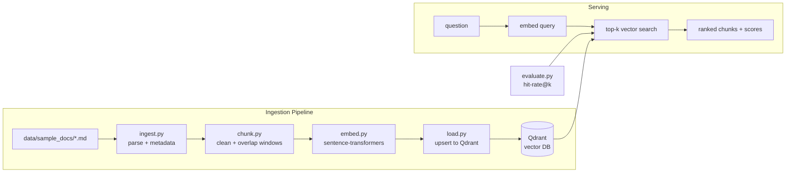

# RAG Data Pipeline

A production-style data pipeline that turns raw documents into a queryable knowledge base: **ingest → clean → chunk → embed → load** into a vector database, with semantic retrieval and retrieval-quality evaluation on top.

Why this matters for data engineers: the ingestion, cleaning, chunking, and embedding pipelines that power RAG are core data engineering work — the same idempotent loads, metadata discipline, and quality metrics we apply to warehouses apply here. This project shows that pipeline thinking end to end.

## Architecture



## Tech Stack

| Component      | Choice                                                        |
| -------------- | ------------------------------------------------------------- |
| Language       | Python 3.10+                                                  |
| Vector DB      | Qdrant (Docker, local)                                        |
| Embeddings     | sentence-transformers `all-MiniLM-L6-v2` (local, CPU, no API keys) |
| Chunking       | Word-based sliding window, 500 words / 100 overlap            |
| Eval           | hit-rate@1, @3, @5 over a labeled question set                |

## Quickstart

Everything runs locally — no cloud accounts, no API keys.

```bash
# 1. Start Qdrant
docker compose up -d

# 2. Install dependencies (use a virtualenv)
pip install -r requirements.txt

# 3. Run the pipeline: ingest -> chunk -> embed -> load
python src/pipeline.py

# 4. Ask a question
python src/retrieve.py --query "How much does the Growth plan cost per user?"

# 5. Evaluate retrieval quality
python src/evaluate.py
```

To rebuild the collection from scratch: `python src/pipeline.py --recreate`.

## Project Structure

```
rag-data-pipeline/
├── data/
│   └── sample_docs/        # Corpus: 8 help-center docs for fictional SaaS "Flowstack"
├── eval/
│   └── questions.json      # 10 labeled eval questions -> expected source doc
├── src/
│   ├── config.py           # Shared tunables (chunk sizes, model, Qdrant connection)
│   ├── ingest.py           # Load md/txt files; split on H2s; extract title/section metadata
│   ├── chunk.py            # Clean text; word-based overlapping windows; keep metadata per chunk
│   ├── embed.py            # Batched local embeddings (lazy-loaded model)
│   ├── load.py             # Idempotent Qdrant collection setup + batched upserts
│   ├── pipeline.py         # End-to-end runner: ingest -> chunk -> embed -> load
│   ├── retrieve.py         # CLI: embed a question, print top-k chunks with scores
│   └── evaluate.py         # hit-rate@k over eval/questions.json
├── docker-compose.yml      # Qdrant service
├── requirements.txt
└── README.md
```

## Design Decisions

**Chunking strategy.** Word-based sliding windows (500 words, 100-word overlap) instead of naive character splits. Word boundaries never cut mid-token, and the overlap preserves context that would otherwise be lost at chunk edges — a question whose answer spans a boundary is still retrievable. Metadata (source, title, section, chunk index, word offsets) travels with every chunk so results are always attributable.

**Embedding model choice.** `all-MiniLM-L6-v2` runs fully locally on CPU with zero API keys or cost, produces compact 384-dim vectors, and is a well-understood baseline for English retrieval. The model name is a config value, so swapping in a larger model (e.g. `bge-large`) is a one-line change — the pipeline doesn't care.

**Idempotency.** Re-running `pipeline.py` is safe: point IDs are deterministic UUID5s of `source#chunk_index`, so upserts overwrite the same points instead of duplicating them, and the collection is created only if missing. `--recreate` exists for the explicit "drop and rebuild" case. This mirrors how production loads treat reprocessing.

**Eval as a first-class step.** Retrieval pipelines degrade silently when chunking or models change. The labeled question set in `eval/questions.json` plus hit-rate@k gives a cheap regression signal — change the chunk size or embedding model, re-run `evaluate.py`, and see whether quality moved.

## Sample Retrieval Output

```bash
$ python src/retrieve.py --query "How much does the Growth plan cost per user?" --top-k 3
```

```
Query: How much does the Growth plan cost per user?

Top 3 results from collection 'flowstack_docs':

[1] score=0.7821 | pricing.md — Flowstack Pricing / Plans & Pricing
    **Growth — $15 per user per month, billed annually ($180 per user per year).** If billed monthly, Growth is $18 per user per month. Includes unlimited workflows, 50,000 workflow ...

[2] score=0.6145 | pricing.md — Flowstack Pricing / Billing FAQ
    **How am I billed?** Subscriptions are billed per active user ("seat"). A user counts as active if they log in or trigger a workflow run during the billing month. Deactivated ...

[3] score=0.4023 | onboarding-guide.md — Flowstack Onboarding Guide / Invite Your Team
    Go to **Settings → Members → Invite**. Enter email addresses separated by commas, or upload a CSV for bulk invites. Assign each person a role: ...
```

## Corpus

The sample corpus is a fictional SaaS help center ("Flowstack") covering pricing, API authentication, webhooks, security policy, onboarding, SSO/SAML setup, data exports, and integrations — realistic enough to exercise section-aware chunking and metadata filtering, with zero proprietary data.

## License

MIT — see [LICENSE](LICENSE).
